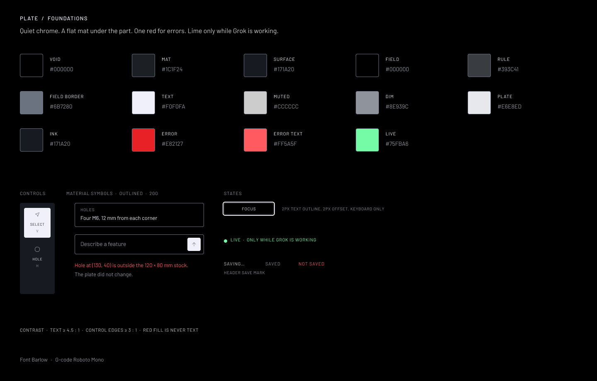
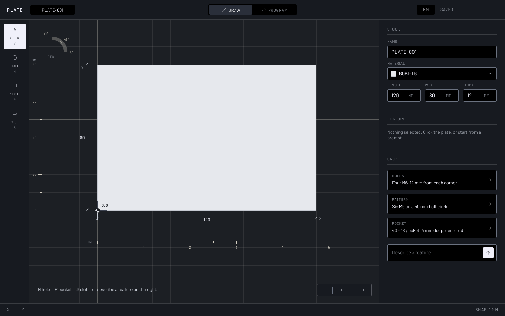
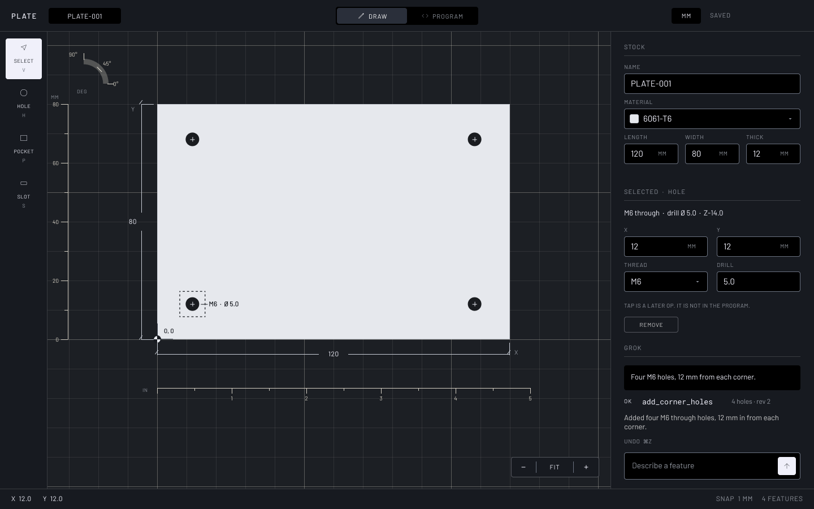
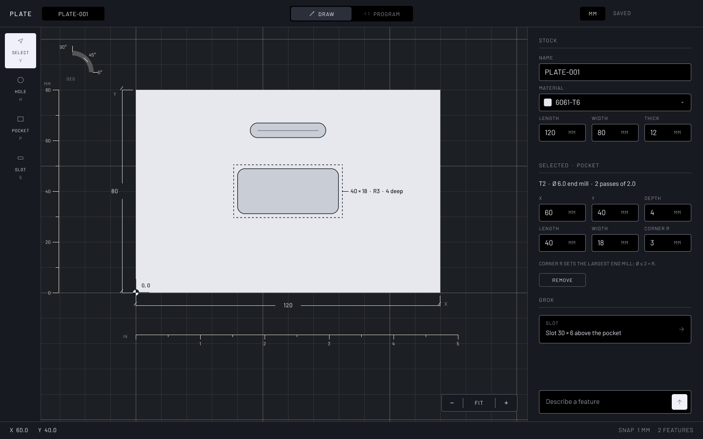
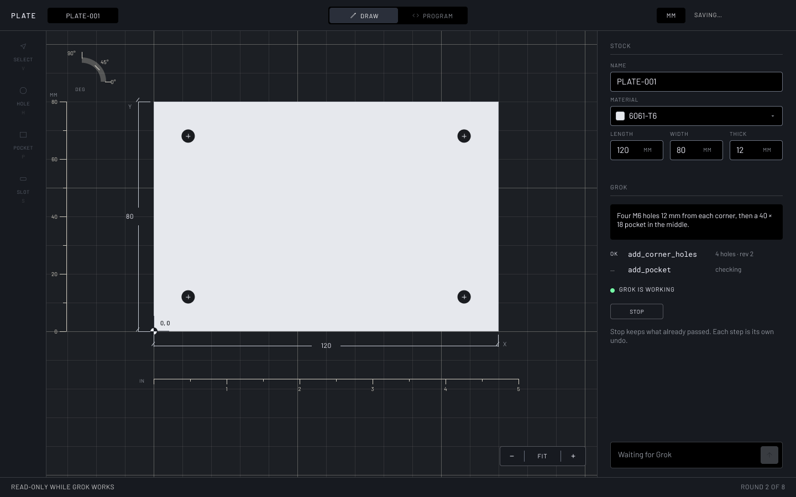
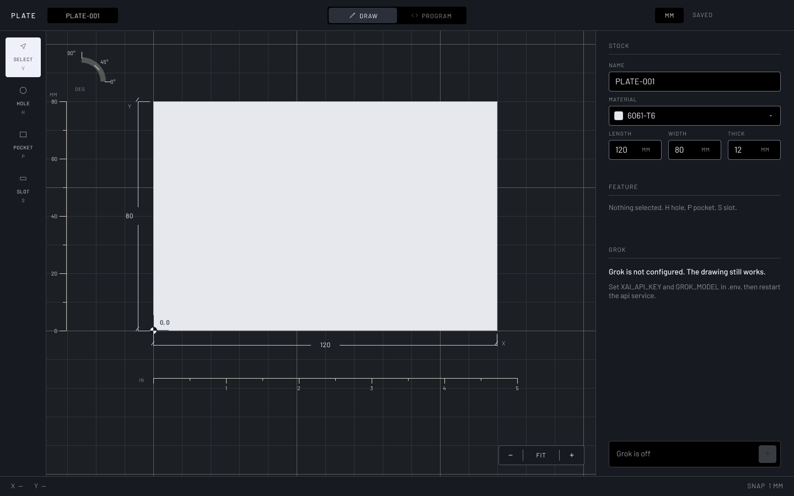
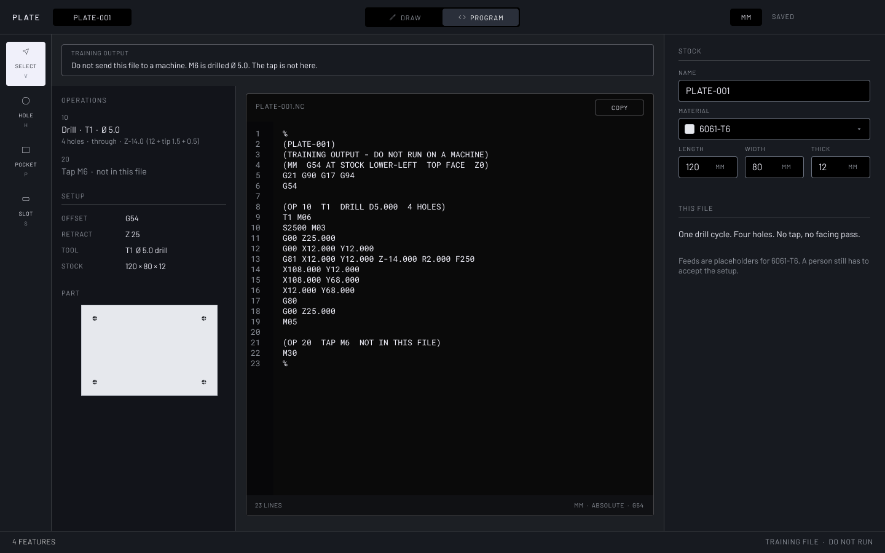
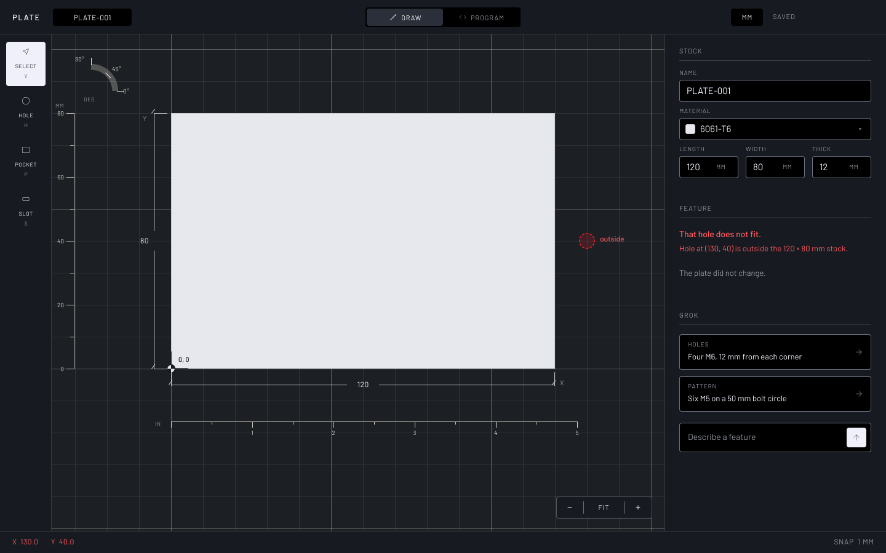

# Design artifact: Plate v1

Plate is a local single-plate mill CAD. Angular draws the part; C# validates every edit, stores it with revisions in SQLite, runs the Grok tool loop over the xAI HTTP API, and writes training-only G-code. The screen is the SpaceX / Tesla / Grok overlap: black void, carbon surfaces, Tesla red only for errors, lime only for the Grok live dot.

## Evidence

Richard, earlier session:

> angluar. lets take teh style from the space x website grok website and tesla lerts cinbiued all the looks iunto one. we dont need python if its not comabtbaile. lets go lets do it

Richard, prior session: Angular confirmed. C# .NET backend. SQLite local. Docker. No Python sidecar once the provider API is plain HTTP.

Richard, 2026-11-13: "act as a consultant … properly make this a production ready project."

Components posting (preferred skills): C#, .NET, Angular or React, Docker, PostgreSQL or SQL Server. Python is listed; it is not required to call `https://api.x.ai/v1`, which is OpenAI-compatible HTTP.

Stack Overflow, 13 May 2021, SpaceX application software (Sepanloo): factory apps were AngularJS, C#, SQL Server; newer apps moved to Angular, containers, and toward PostgreSQL.

Public sites sampled 2026: spacex.com `#000000`, `#F0F0FA`, `#CCCCCC`, D-DIN, tracked uppercase, ghost button, 4px radius. tesla.com `#171A20`, `#393C41`, `#E82127` used sparingly. x.ai near-black, `#75FBA6` as a live accent only.

Review of the previous proposal (lines from the pre-review docs):

| Quote | Problem | Now |
| --- | --- | --- |
| `docs/security.md:17` "`api` publishes `127.0.0.1:8080` only" with `:16` "nginx proxies `/api/` to `api`" | A second open door to the API; CORS needed for no reason | `api` has no host port; same origin; no CORS |
| `docs/security.md` (absent) | Any web page can POST to localhost and spend the key | Origin + Host allowlist, JSON-only POST, rate and daily limits |
| `docs/backend.md:127` "An M6 hole in a 12 mm plate emits … `Z-12`" | A 118° drill stopped at the bottom face does not break through | `Z-14.000` = 12 + 0.3·5.0 + 0.5 |
| `docs/backend.md:38` "Corner radius 0 to half the short side" | An end mill cannot cut a sharp inside corner | Radius ≥ 0.5 mm; tool Ø ≤ 2R |
| `docs/backend.md` (absent) | No number culture rule; `de-DE` prints `12,5` | One invariant-culture formatter, golden tests |
| `docs/backend.md:23` features table | No overlap or wall rule; two features could intersect | 1 mm edge wall and feature wall |
| `docs/frontend.md:29` "keep up to 50 previous part payloads … re-sends the inverse action" | Client undo diverges from SQLite and cannot undo Grok | `part_revisions`, `/undo`, `/redo` |
| `docs/backend.md` (absent) | Two tabs, or a drag during a Grok turn, silently overwrite | `version` on every write; 409; per-part lock during chat |
| `docs/backend.md:100` "prior … text (capped)" | Cap, timeouts, retries, token limit unspecified | 10 turns / 8,000 chars, 30 s, 2 retries, 90 s, `max_tokens` 1,024 |
| `docs/design.md:21,24` Canvas `#1C1F24`, Hairline `#4A5160` vs `AGENTS.md` canvas `#000000`, hairline `#393C41` | Two palettes | One token table in `design.md` |
| Figma `field()` stroke `#2E3440` | Input edge 1.4:1 on surface | `field-border` `#6B7280`, 3.6:1 |
| Figma error text `#E82127` on `#171A20` | 3.9:1, fails AA | `error-text` `#FF5A5F`, 5.7:1 |
| Figma Program board | Grid and angle gauge visible behind the ops column | Plain mat |
| Figma (absent) | No pocket, slot, Grok working, or Grok off frames | Three new boards |
| `docs/design.md:37` "Three modes" | Two are listed | Two modes |
| Repo (absent) | No README, `.gitignore`, `.env.example`, CI, ops, or test plan | Added |

## Mockups

Figma file `space_x_proj`, page `Plate`, built by `design/figma/screens.js`. Barlow UI, Roboto Mono G-code.

Before: no screen exists. The previous boards are replaced in place.

| After | |
| --- | --- |
|  | Foundations: 14 tokens, controls, focus ring, save states |
|  | Draw: empty |
|  | Draw: four holes: trace row, undo hint, composer kept |
|  | Draw: pocket and slot: pocket inspector, tool note |
|  | Draw: Grok working: live dot, read-only rail, Stop |
|  | Draw: Grok off: 503 state |
|  | Program: plain mat, `Z-14.000`, `%` delimiters |
|  | Draw: rejected: server sentence in `error-text` |

## Diagrams

| Diagram | File |
| --- | --- |
| Components | [diagrams/uml-component-plate.drawio](diagrams/uml-component-plate.drawio) |
| Deployment | [diagrams/uml-deploy-compose.drawio](diagrams/uml-deploy-compose.drawio) (new) |
| Chat sequence | [diagrams/uml-seq-chat.drawio](diagrams/uml-seq-chat.drawio) |
| Editor state | [diagrams/uml-state-editor.drawio](diagrams/uml-state-editor.drawio) |
| Execute action | [diagrams/gfd-apply.drawio](diagrams/gfd-apply.drawio) |
| Build program | [diagrams/gfd-program.drawio](diagrams/gfd-program.drawio) (new) |
| ERD and API shape | [diagrams/erd-plate.drawio](diagrams/erd-plate.drawio) (two pages) |

## Schema

New database; no migration from a previous schema. ＋ marks what the review added.

| Table | Columns |
| --- | --- |
| `parts` | `id` PK, `name`, `material`, `length_mm`, `width_mm`, `thickness_mm`, ＋`version`, `created_at`, `updated_at` |
| `features` | `id` PK, `part_id` FK cascade, `type` CHECK, `x_mm`, `y_mm`, `depth_mm`, ＋`through`, `diameter_mm`?, `thread`?, `length_mm`?, `width_mm`?, `corner_radius_mm`?, `angle_deg`?, ＋`sort_order` |
| ＋`part_revisions` | `id` PK, `part_id` FK cascade, `version` (unique per part), `source` CHECK, `action`, `args_json`, `snapshot_json`, `chat_message_id` FK?, `created_at` |
| `chat_messages` | `id` PK, `part_id` FK cascade, `role` CHECK, `body`, `trace_json`?, ＋`status` CHECK, ＋`model`?, `created_at` |

API shape: `{ name, args, version }` in, Part out; error body `{ error, code, field, requestId }`; routes and status codes in `docs/backend.md`.

## Pseudocode

```
Execute(partId, expectedVersion, source, name, args):
  part = load(partId)                          # 404 if missing
  if part.version != expectedVersion: return 409 version_conflict
  if chatLock.held(partId) and source != grok: return 409 grok_busy
  copy = clone(part)
  if name not in Actions: return 422 unknown_action
  if not schema(name).accepts(args) or any non-finite: return 422 invalid_args
  mutate copy from args
  for rule in [limits, edgeWall 1mm, featureWall 1mm]:
    if rule fails: return 422 {sentence with numbers, code, field}   # part unchanged
  in one transaction:
    copy.version = part.version + 1
    save copy, its features, revision(source, name, args, snapshot(copy))
  on concurrency exception: return 409 version_conflict
  return 200 copy

Undo(partId, expectedVersion):
  target = revision(partId, version = the one before the current state)
  if none: return 422 nothing_to_undo
  Execute-like commit of target.snapshot as a new revision, source = undo

Chat(partId, message, version):
  if no key or model: return 503 grok_not_configured
  if rate limited: return 429
  if not chatLock.tryTake(partId): return 409 grok_busy
  try:
    part = load(partId); check version (409)
    store user message
    thread = system prompt + part JSON + last 10 turns (≤ 8000 chars) + message
    for round in 1..8 while elapsed < 90 s and client connected:
      reply = xai(thread, tools, max_tokens 1024)    # 30 s, retry 429/5xx twice
      if reply has no tool calls: break
      for call in reply.toolCalls, in order:
        result = Execute(partId, part.version, grok, call.name, call.args)
        trace.add(call, result)
        thread.add(tool result: summary or the 422 sentence)
        if result ok: part = result
    text = reply.text or sentence built from trace
    store assistant message (trace, status, model)
    return 200 {text, trace, part}            # 502/504 carry trace and part too
  finally:
    chatLock.release(partId)

Program(part):
  lines = ["%", "(" + sanitize(part.name) + ")", "(TRAINING OUTPUT - DO NOT RUN ON A MACHINE)", header…]
  lines += ["G21 G90 G17 G94", "G54"]
  for group in holes grouped by drill Ø, smallest first:
    z = through ? -(t + 0.3·D + 0.5) : -(depth + 0.3·D)
    emit tool change, spindle, G81 per hole nearest-neighbour, G80, Z25, M05
  for f in pockets and slots:
    tool = largest end mill with Ø ≤ (pocket ? min(2R, short side) : width)
    if none: issues.add(error, f); continue
    emit passes: axial ≤ 0.5·Ø, stepover 40 %
  for tap in threaded holes: operations.add("Tap … not in this file"); issues.add(warning)
  lines += ["M30", "%"]
  every number: fmt(x) = x.ToString("0.000", InvariantCulture), "-0.000" → "0.000"
  runnable = no skipped feature and no error issue
  return lines, operations, issues, runnable, moves
```
